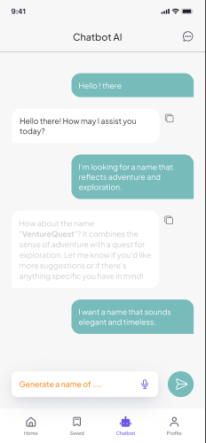
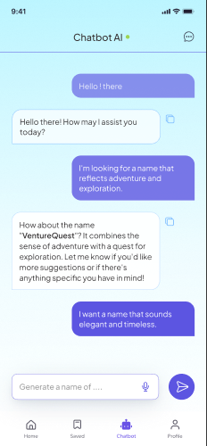
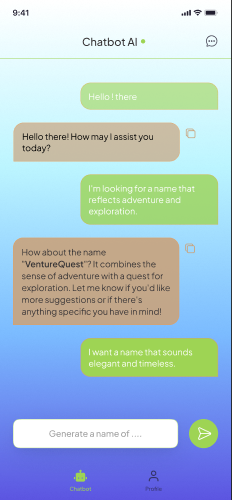
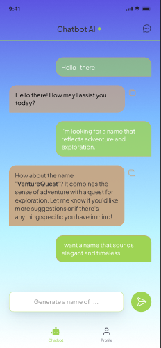
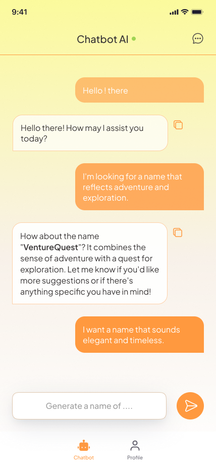
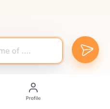
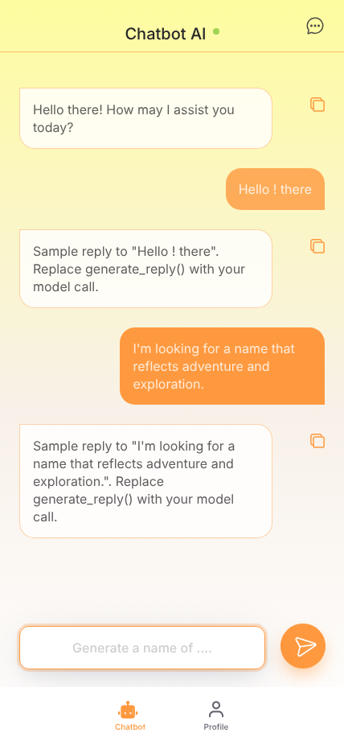

# 제주 여행 챗봇 — UI 개발 기록

> 브랜치 `feature/UI` · Gradio 6 · Python 3.11
> Figma: [AI chatbot mobile app design (Community) 기반 작업 파일](https://www.figma.com/design/FigjY4FL97JdK6zaszshng/AI-chatbot-mobile-app-design-both-dark-and-light-mode--Community-?node-id=0-1)

## 목차

1. [챗봇 디자인](#1-챗봇-디자인)
2. [색상 선정](#2-색상-선정)
3. [Figma 디자인 초안](#3-figma-디자인-초안)
4. [Gradio로 구현](#4-gradio로-구현)
5. [Frontend 완성](#5-frontend-완성)
6. [부록 — 실행 방법 / 작업 이력](#6-부록)

---

## 1. 챗봇 디자인

### 1.1 목표
- 제주 여행 정보를 대화로 안내하는 **모바일 우선 챗봇** 화면
- 여행 앱 사용자가 익숙한 메신저형 UI (말풍선 + 하단 입력창 + 하단 탭)
- 백엔드(LLM / RAG) 연동 전에도 화면과 인터랙션을 먼저 완성해, 백엔드는 **함수 하나만 연결**하면 되도록 설계

### 1.2 참고 디자인
- Figma Community의 *AI chatbot mobile app design (dark & light mode)* 템플릿을 복제해 출발점으로 사용
- 템플릿의 화면 중 **채팅 화면(Home)** 을 기준으로 제주 챗봇에 맞게 수정

### 1.3 화면 구성

| 영역 | 구성 요소 | 비고 |
|---|---|---|
| 헤더 | 타이틀 `Chatbot AI`, 온라인 표시(초록 점), 새 대화 아이콘 | 하단 구분선 |
| 대화 영역 | 사용자 말풍선(오른쪽), 봇 말풍선(왼쪽) + 복사 버튼 | 마크다운(굵게 등) 지원 |
| 입력 영역 | 텍스트 입력창 + 원형 전송 버튼 | 그림자로 떠 있는 느낌 |
| 하단 탭 | Chatbot / Profile | |

### 1.4 템플릿에서 바꾼 점

| 템플릿 | 제주 챗봇 | 이유 |
|---|---|---|
| 하단 탭 4개 (Home / Saved / Chatbot / Profile) | **2개 (Chatbot / Profile)** | MVP 범위를 채팅에 집중 |
| 입력창 마이크 아이콘 | **제거** | 음성 입력은 이번 범위에서 제외 |
| 회색 배경 + 청록 말풍선 | **제주 컬러 팔레트** (2장 참고) | 서비스 정체성 반영 |

---

## 2. 색상 선정

### 2.1 후보 비교
같은 레이아웃에 색만 바꾼 시안 5개를 Figma에서 나란히 놓고 비교했습니다.

| ① 초안 (템플릿 기본) | ② Sky + Purple | ③ Sky + Green | ④ Violet + Green | ⑤ **Sand (선정)** |
|:-:|:-:|:-:|:-:|:-:|
|  |  |  |  |  |
| 회색 배경, 청록 말풍선 | 하늘색 그라데이션, 보라 말풍선 | 하늘→파랑 그라데이션, 연두/베이지 말풍선 | 보라→하늘 그라데이션, 연두/베이지 말풍선 | 노랑→크림→흰색 그라데이션, 주황 말풍선 |

| 시안 | 장점 | 아쉬운 점 |
|---|---|---|
| ① 초안 | 깔끔함 | 제주 느낌이 없고 무채색이라 밋밋함 |
| ② Sky + Purple | 바다·하늘 연상 | 보라색이 제주 이미지와 거리가 멂 |
| ③ Sky + Green | 바다 + 오름 연상 | 진한 배경 위 베이지 말풍선의 가독성이 떨어짐 |
| ④ Violet + Green | 화사함 | 색이 많아 산만하고, ③과 같은 가독성 문제 |
| ⑤ **Sand** | 감귤·유채꽃·모래사장 연상, 밝은 배경이라 본문이 잘 읽힘 | 흰 글자 + 주황 말풍선 대비가 낮음 (2.4 참고) |

### 2.2 선정 이유 — Sand 팔레트
- **주황 `#FF993F`**: 제주 감귤 → 브랜드 포인트 컬러 (전송 버튼, 사용자 말풍선, 활성 탭, 아이콘)
- **노랑 그라데이션**: 봄 유채꽃 → 상단 배경
- **크림 / 흰색**: 모래사장 → 하단으로 갈수록 밝아져 입력창 주변이 깔끔함
- 배경이 밝아서 본문(`#373435`)의 가독성이 다른 시안보다 좋음

### 2.3 최종 팔레트

| 토큰 (`assets/tokens.css`) | 값 | 용도 |
|---|---|---|
| `--color-primary` | `#FF993F` | 포인트 컬러 (전송 버튼, 활성 탭, 아이콘) |
| `--color-online` | `#9ED454` | 헤더 온라인 표시 |
| `--color-text` | `#373435` | 본문, 헤더 타이틀 |
| `--color-text-strong` | `#201D2F` | 비활성 탭, 아이콘 (Figma style *Black*) |
| `--color-text-muted` | `#9E9E9E` | 입력창 안내 문구 (Figma style *textcolor*) |
| `--bg-app` | `rgba(254,252,158,.99)` → `#F8F1E9` (55%) → `#FFFFFF` | 화면 배경 그라데이션 |
| `--bubble-user-bg` | `#FF993F` 80% | 사용자 말풍선 (최신 말풍선은 100%) |
| `--bubble-bot-bg` | `#FFFFFF` 80% | 봇 말풍선 |
| `--bubble-bot-border` | `#FF993F` 45% | 봇 말풍선 테두리 |
| `--input-border` | `rgba(201,163,124,.6)` | 입력창 테두리 |
| `--shadow-700` | `0 8px 22px -6px`, `0 14px 64px -4px` (`#18274B` 12%) | 입력창 그림자 (Figma *Shadow / 700*) |

### 2.4 접근성 체크
| 조합 | 명도 대비 | WCAG AA (4.5:1) |
|---|---|---|
| 본문 `#373435` / 봇 말풍선(흰색 계열) | 약 12.1 : 1 | ✅ 통과 |
| 흰 글자 / 주황 `#FF993F` (사용자 말풍선) | 약 2.1 : 1 | ⚠️ 미달 |
| 안내 문구 `#9E9E9E` / 흰색 | 약 2.7 : 1 | ⚠️ 미달 (placeholder라 영향은 작음) |

→ 사용자 말풍선 글자 대비는 **후속 개선 과제**로 남김 (5.5 참고). 검토한 대안:

| 대안 | 명도 대비 | 비고 |
|---|---|---|
| 말풍선 글자를 `#373435`로 (배경 주황 유지) | 약 5.8 : 1 ✅ | 색감 유지, 가장 간단 |
| 말풍선 글자를 `#201D2F`로 (배경 주황 유지) | 약 7.7 : 1 ✅ | 대비 가장 높음 |
| 흰 글자 유지 + 배경을 `#B85A00`으로 | 약 4.7 : 1 ✅ | 주황이 갈색에 가까워져 디자인 인상이 바뀜 |

---

## 3. Figma 디자인 초안

### 3.1 작업 순서
1. 커뮤니티 템플릿 복제 → 채팅 화면(`jeju chatbot`) 프레임 생성
2. 하단 탭, 입력창 등 범위 밖 요소 정리 (1.4 참고)
3. 같은 프레임을 복제해 색상 시안 4종 제작 → 비교 (2장)
4. 선정한 시안을 **컴포넌트 `jeju chatbot - palette (sand)`** (node `1062:404`)로 지정 → 개발 기준 화면으로 확정

### 3.2 레이아웃 스펙 (개발 기준값)

| 항목 | 값 |
|---|---|
| 화면 크기 | 428 × 926 (iPhone Pro Max 기준) |
| 좌우 여백 | 24px |
| 헤더 높이 | 45px (+ 하단 구분선) |
| 말풍선 | 모서리 19px (말꼬리 쪽 모서리만 0), 안쪽 여백 15px 16px, 간격 24px |
| 말풍선 최대 폭 | 사용자 255px(약 67%), 봇 308px |
| 입력창 | 높이 54px, 모서리 12px |
| 전송 버튼 | 54px 원형 |
| 하단 탭 | 높이 72px, 탭 간격 66px |
| 폰트 | Plus Jakarta Sans — 타이틀 20px Medium, 본문 16px Regular, 탭 10px Medium |

### 3.3 개발 전달 시 정리한 사항
- 입력창 레이어 이름(`편하게 물어보세요!...`)과 실제 표시 문구(`Generate a name of ....`)가 달라서 → **언어별로 분리** (ko / en)
- 컴포넌트 안에 화면 밖으로 벗어난 아이콘 레이어(`briefcase 1`)가 남아 있음 → 구현에서 제외
- 사용자 말풍선 투명도가 0.6 → 0.8 → 1.0으로 점점 진해짐 → 구현에서는 "최신 말풍선만 진하게"로 단순화

---

## 4. Gradio로 구현

### 4.1 기술 스택
| 구분 | 사용 |
|---|---|
| UI 프레임워크 | Gradio 6 (`gr.Blocks`, `gr.Chatbot`) |
| 스타일 | CSS 변수(디자인 토큰) + 컴포넌트 CSS |
| 인터랙션 | 순수 JS (`effects.js`) |
| 문구 관리 | JSON (`strings.json`, en / ko) |
| 디자인 추출 | Figma MCP (`get_design_context`, Plugin API로 아이콘 SVG/PNG 추출) |

### 4.2 파일 구조와 역할 분리
```
app.py              UI 구성 + 이벤트 연결 (백엔드 연결 지점 generate_reply)
requirements.txt    gradio>=6.0
assets/
  strings.json      화면 문구 (en 기본 / ko)
  tokens.css        디자인 토큰 — 색, 크기, 그림자, 모션 (디자인 수정은 여기만)
  app.css           토큰을 사용하는 컴포넌트 스타일 + 애니메이션
  effects.js        리플, 전송 애니메이션, 라이트 모드 고정
  icons/            Figma에서 추출한 아이콘 6종
```
- 초기에는 스타일을 `style_css.py` 파일에 문자열로 두었으나, **디자인 / 문구 / 로직을 파일 단위로 분리**하는 구조로 변경
- 디자인 변경 → `tokens.css`, 문구 변경 → `strings.json`, 기능 변경 → `app.py` 만 수정하면 됨

### 4.3 Figma → 코드 변환 과정
1. `get_design_context`로 컴포넌트의 색, 크기, 여백, 폰트 값을 추출
2. 추출한 값을 `tokens.css`의 CSS 변수로 정리 (하드코딩 금지)
3. 아이콘은 Figma Plugin API로 **원본 SVG / PNG를 그대로 export** → `assets/icons/`
4. 아이콘은 `app.py`가 실행 시 data URI로 변환해 CSS 변수(`--icon-send` 등)로 주입 → 배포 경로와 상관없이 표시됨
5. Gradio로 화면을 띄워 **Figma 캡처와 나란히 비교**하며 차이를 수정

### 4.4 Gradio 제약과 해결

| 문제 | 해결 |
|---|---|
| `gr.Chatbot` 기본 Clear 버튼이 표시됨 | CSS로 숨김 |
| 복사 버튼이 말풍선 아래에 붙음 (디자인은 오른쪽) | 대화 영역을 CSS Grid 2열로 바꿔 말풍선 옆에 배치 |
| 사용자 말풍선에도 복사 버튼이 생김 | 사용자 쪽 버튼 숨김 |
| Gradio 6이 메시지를 `[{"type":"text","text":...}]` 형태로 돌려줌 | `message_text()`로 항상 문자열로 정리 |
| Gradio 기본 여백(16px 32px) 때문에 레이아웃이 밀림 | 컨테이너 여백 0, 428px 폭 고정 |
| 헤더와 입력창 줄이 좁은 화면에서 줄바꿈됨 | `flex-wrap: nowrap` |
| 하단 탭 아이콘 색을 상태별로 바꾸기 어려움 | 아이콘을 CSS `mask`로 그려 글자색(`currentColor`)을 따라가게 함 |
| OS 다크 모드에서 Gradio가 `.dark` 테마를 적용해 글자가 흰색이 됨 | `effects.js`에서 `.dark` 클래스를 제거해 **라이트 모드 고정** |
| 한글 문장이 단어 중간에서 줄바꿈됨 | `word-break: keep-all` |
| Figma 에셋 URL이 사내 네트워크에서 차단됨 | Plugin API로 SVG 문자열 / PNG를 직접 추출 |

### 4.5 버튼 반응형 애니메이션

| 대상 | 동작 |
|---|---|
| 전송 버튼 | 마우스 올림: 살짝 떠오름 + 주황 그림자 / 누름: 축소 + 리플 / 전송: 종이비행기가 날아갔다 다시 등장 / 답변 중: 잠금 + 펄스 링 |
| 하단 탭 | 누름: 축소 + 리플 / 선택: 아이콘 바운스 + 주황색 |
| 복사 버튼 | 마우스 올림: 확대 / 복사 완료: 체크 아이콘이 톡 튀어나옴 |
| 새 대화 버튼 | 마우스 올림: 살짝 기울어짐 |
| 말풍선 | 아래에서 올라오며 등장 |
| 입력창 | 포커스 시 주황 테두리 + 링 |
| 온라인 표시 | 천천히 퍼지는 링 |

- 모션 값(시간, 이징)도 `tokens.css`의 `--dur-*`, `--ease-*` 변수로 관리
- OS의 **"동작 줄이기"** 설정 시 모든 애니메이션 자동 비활성화 (`prefers-reduced-motion`)



### 4.6 다국어
- 모든 화면 문구는 `assets/strings.json`에서 읽음 (`S["chat"]["greeting"]` 형식)
- 기본 언어 **영어(en)**, 환경변수 `APP_LOCALE=ko`로 한국어 전환
- 새 문구는 en / ko 양쪽에 같은 키로 추가해야 함 (없으면 `KeyError`)

---

## 5. Frontend 완성

### 5.1 최종 화면

| Figma (기준) | Gradio (구현) |
|:-:|:-:|
|  |  |

### 5.2 완성 기능
- [x] 메시지 전송 (Enter / 전송 버튼), 빈 메시지 경고
- [x] 답변 스트리밍 표시, 답변 중 전송 버튼 잠금
- [x] 봇 답변 복사
- [x] 새 대화 (인사말만 남기고 초기화)
- [x] Profile 탭 → "준비 중" 알림창 표시 후 Chatbot 탭 유지
- [x] 영어 / 한국어 문구 전환
- [x] OS 다크 모드에서도 라이트 테마 유지
- [x] 버튼 애니메이션, 동작 줄이기 대응
- [ ] 실제 답변 생성 (백엔드 연동 대기)
- [ ] 프로필 화면

### 5.3 백엔드 연동 포인트
백엔드는 `app.py`의 **`generate_reply(message, history)` 하나만** 구현하면 됩니다.

```python
def generate_reply(message: str, history: History) -> Iterator[str]:
    # history = [{"role": "assistant"|"user", "content": str}, ...]  (OpenAI messages 형식)
    # 답변 문자열을 조각 단위로 yield → 화면에 스트리밍 표시
    # 예외 발생 시 화면에 S["chat"]["error"] 문구 표시
```
- 세션 구분이 필요하면 `stream_bot`에 `request: gr.Request` 추가 → `request.session_hash`
- 자세한 내용은 `app.py` 상단 "백엔드 연동 가이드" 주석 참고

### 5.4 테스트 / 트러블슈팅 기록

| 증상 | 원인 | 조치 |
|---|---|---|
| 다크 모드에서 타이틀, 본문이 흰색으로 표시 | Gradio가 OS 설정을 따라 `.dark` 테마 적용 | 라이트 모드 고정 |
| 실행 시 `KeyError: 'title'` | `strings.json`은 갱신되고 `app.py`는 이전 버전으로 남음 (프로필 화면 코드가 삭제된 키를 참조) | `app.py` 최신화, 코드가 쓰는 문구 키가 en / ko에 모두 있는지 확인 |

검증 방법: Playwright로 428×926 화면을 띄워 라이트 / 다크 모드 각각 캡처, Figma 캡처와 비교. 알림창 표시, 탭 상태, 입력창 포커스는 스크립트로 확인.

### 5.5 알려진 제한 / 후속 작업
- [ ] 백엔드 연동 (`generate_reply`)
- [ ] 프로필 화면 디자인 및 구현
- [ ] 사용자 말풍선 글자 대비 개선 (현재 약 2.1:1, 2.4 참고)
- [ ] 사용자 말풍선 투명도 단계(0.6 → 0.8 → 1.0) 재현 여부 결정
- [ ] 폰트를 Google Fonts에서 불러옴 → 외부망이 막힌 배포 환경이면 폰트 파일을 `assets/`에 포함
- [ ] `__pycache__` 등을 `.gitignore`에 추가

---

## 6. 부록

### 6.1 실행 방법
```bash
pip install -r requirements.txt
python app.py                           # 영어 (기본)
$env:APP_LOCALE="ko"; python app.py     # 한국어 (PowerShell)
# macOS / Linux: APP_LOCALE=ko python app.py
```
브라우저에서 http://127.0.0.1:7860 접속. 모바일 화면은 개발자 도구의 기기 모드(428px)로 확인.

### 6.2 작업 이력 (`feature/UI`)
| 커밋 | 내용 |
|---|---|
| `feat: UI디자인 초안 작성` | Gradio 화면 초안 |
| `feat: style_css py파일로 분리.` | 스타일 코드 분리 |
| `feat : 프론트엔드 모든 작업 완료` | Figma 기반 화면 완성, 토큰 / 문구 / 아이콘 분리, 애니메이션, 다국어, 라이트 모드 고정, Profile 알림 |

### 6.3 버전
| 항목 | 버전 |
|---|---|
| Python | 3.11 |
| Gradio | 6.x (6.30에서 검증) |
